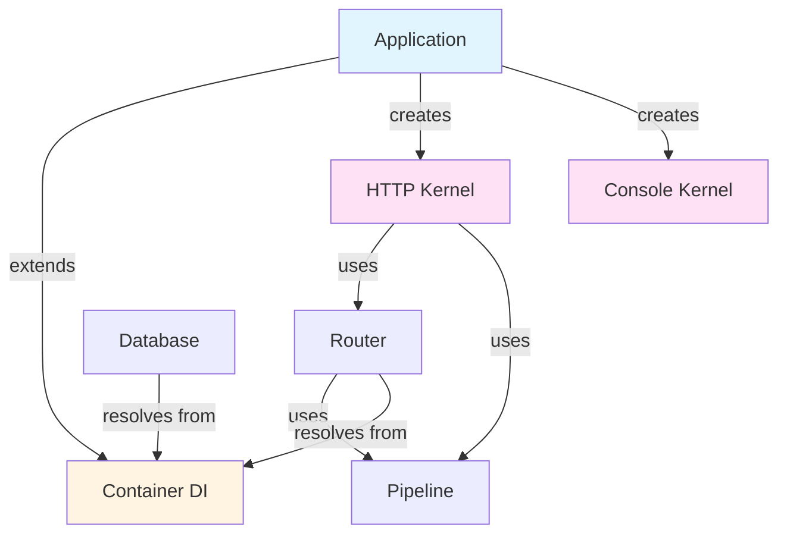
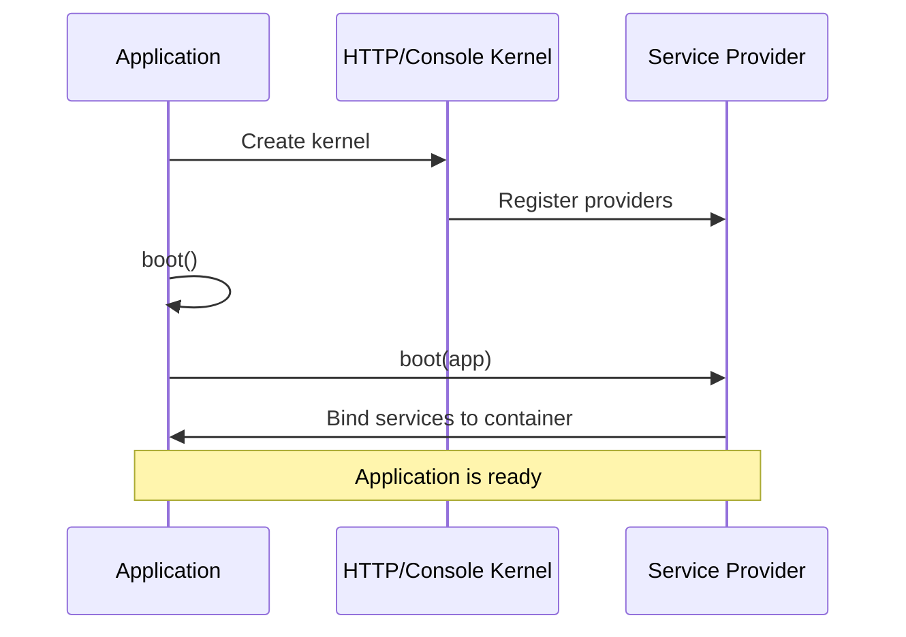
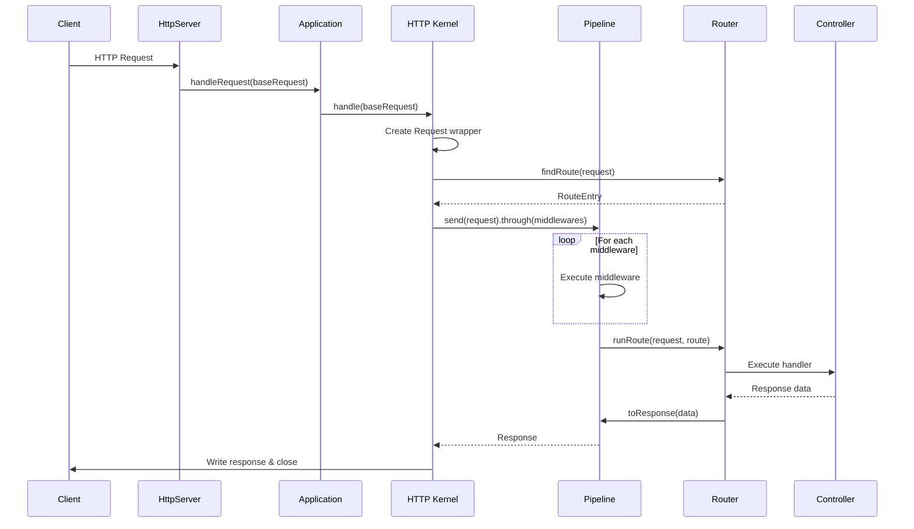
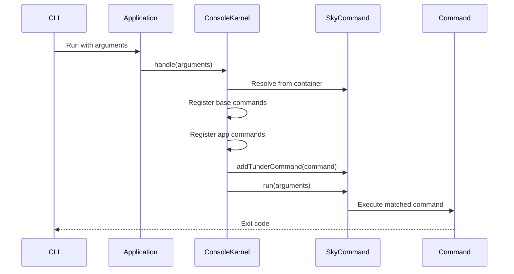

# Tunder Framework Architecture

**Version**: 0.2.1  
**Last Updated**: October 11, 2025

---

## Table of Contents

1. [Overview](#overview)
2. [Framework Philosophy](#framework-philosophy)
3. [Tech Stack](#tech-stack)
4. [System Architecture](#system-architecture)
5. [Project Structure](#project-structure)
6. [Core Design Patterns](#core-design-patterns)
7. [Layer Architecture](#layer-architecture)
8. [Request Lifecycle](#request-lifecycle)
9. [Key Components](#key-components)

---

## Overview

**Tunder** is a modern backend web framework for Dart, designed to build robust server-side applications. Inspired by Laravel's elegance and developer experience, Tunder provides a comprehensive toolkit for building APIs and backend services with Dart.

### Key Features

- ✅ **Dependency Injection Container** — Automatic dependency resolution with reflection
- ✅ **HTTP Layer** — Routing, controllers, middleware pipeline
- ✅ **Database Layer** — Fluent query builder, ORM-style models, migrations, schema builder
- ✅ **Console Layer** — Artisan-style CLI commands for development tasks
- ✅ **Service Providers** — Modular service registration and bootstrapping
- ✅ **Pipeline Pattern** — Middleware chain execution
- ✅ **100% Test Coverage** — Production-ready with comprehensive test suite

### Framework Goals

1. **Developer Experience** — Intuitive APIs inspired by Laravel
2. **Type Safety** — Leverage Dart's strong typing
3. **Modularity** — Service provider architecture for extensibility
4. **Testability** — Built with testing in mind from day one
5. **Performance** — Efficient request handling with minimal overhead

---

## Framework Philosophy

Tunder follows these architectural principles:

### 1. Convention over Configuration

The framework provides sensible defaults while allowing customization when needed. Table names are inferred from model classes, routes can be auto-discovered, and configuration follows predictable patterns.

### 2. Service-Oriented Architecture

Core functionality is organized into service providers that can be registered, booted, and extended. This allows for modular, testable, and maintainable code.

### 3. Dependency Injection First

The container is the heart of the framework. All major components are resolved through DI, making the codebase testable and decoupled.

### 4. Pipeline Pattern for Middleware

HTTP requests flow through a middleware pipeline using a fold-based functional approach, providing clean request/response transformation.

### 5. Fluent APIs

APIs are designed to be chainable and expressive (query builder, route definitions, schema builder).

---

## Tech Stack

### Core Dependencies

| Package          | Version         | Purpose                       |
| ---------------- | --------------- | ----------------------------- |
| **dart**         | >=2.17.0 <3.0.0 | Language runtime              |
| **http**         | ^0.13.4         | HTTP client utilities         |
| **postgres**     | ^2.4.6          | PostgreSQL driver             |
| **path**         | ^1.8.1          | Path manipulation             |
| **collection**   | ^1.16.0         | Collection utilities          |
| **slugify**      | ^2.0.0          | String slugification          |
| **recase**       | ^4.0.0          | String case conversion        |
| **inflection3**  | ^0.5.3+2        | Pluralization/singularization |
| **dotenv**       | ^4.0.1          | Environment configuration     |
| **args**         | ^2.3.1          | Command-line argument parsing |
| **mason_logger** | ^0.1.1          | CLI logging and formatting    |
| **stack_trace**  | ^1.10.0         | Stack trace utilities         |
| **clock**        | ^1.1.1          | Time abstractions for testing |
| **intl**         | ^0.17.0         | Internationalization          |
| **colorx**       | ^1.0.0          | Console color output          |

### Development Dependencies

| Package      | Version | Purpose           |
| ------------ | ------- | ----------------- |
| **test**     | ^1.20.2 | Testing framework |
| **coverage** | ^1.3.2  | Code coverage     |
| **mocktail** | ^0.3.0  | Mocking library   |

### Supported Databases

- ✅ **PostgreSQL** (v2.4.6+)
- 🚧 **MySQL** (planned)
- 🚧 **SQLite** (planned)

---

## System Architecture

Tunder follows a **layered architecture** with clear separation of concerns:

```
┌─────────────────────────────────────────────────┐
│          Application Entry Point                │
│     (HTTP Server / Console Commands)            │
└─────────────────────────────────────────────────┘
                      │
                      ▼
┌─────────────────────────────────────────────────┐
│              Kernel Layer                       │
│   ┌─────────────────┐   ┌──────────────────┐   │
│   │  HTTP Kernel    │   │  Console Kernel  │   │
│   └─────────────────┘   └──────────────────┘   │
└─────────────────────────────────────────────────┘
                      │
                      ▼
┌─────────────────────────────────────────────────┐
│           Service Provider Layer                │
│  (DatabaseServiceProvider, CommandService, etc) │
└─────────────────────────────────────────────────┘
                      │
                      ▼
┌─────────────────────────────────────────────────┐
│              Core Framework                     │
│   ┌──────────────┐  ┌────────────────────┐     │
│   │  Container   │  │  Service Provider  │     │
│   │  (DI System) │  │    Base Class      │     │
│   └──────────────┘  └────────────────────┘     │
└─────────────────────────────────────────────────┘
                      │
        ┌─────────────┼─────────────┐
        ▼             ▼             ▼
┌─────────────┐ ┌──────────┐ ┌──────────────┐
│  HTTP Layer │ │ Database │ │Console Layer │
│             │ │  Layer   │ │              │
│ • Router    │ │ • Query  │ │ • Commands   │
│ • Request   │ │ • Models │ │ • CLI        │
│ • Response  │ │ • Schema │ │              │
│ • Middleware│ │ • Migrate│ │              │
└─────────────┘ └──────────┘ └──────────────┘
```

### Component Relationships



---

## Project Structure

### Monorepo Organization

```
tunder/                          # Root monorepo
├── melos.yaml                   # Monorepo configuration
├── tool/                        # Build and CI scripts
│   ├── combine_coverage.sh
│   └── pana_score.sh
├── tunder/                      # Main framework package
│   ├── lib/
│   │   ├── tunder.dart         # Main export (Application, ServiceProvider)
│   │   ├── contracts.dart      # Framework contracts/interfaces
│   │   ├── http.dart           # HTTP layer exports
│   │   ├── database.dart       # Database layer exports
│   │   ├── console.dart        # Console layer exports
│   │   ├── extensions.dart     # Dart extensions
│   │   ├── utils.dart          # Utility functions
│   │   └── src/                # Framework implementation
│   │       ├── core/           # Core framework (Container, Application, etc)
│   │       ├── http/           # HTTP layer (Router, Request, Response, etc)
│   │       ├── database/       # Database layer (Query, Model, Schema, etc)
│   │       ├── console/        # Console layer (Commands, Kernel)
│   │       ├── contracts/      # Interface definitions
│   │       ├── exceptions/     # Exception hierarchy
│   │       └── utils/          # Internal utilities
│   ├── templates/              # Code generation templates
│   │   └── stubs/
│   │       └── migrations/
│   │           └── migration.stub
│   ├── test/                   # Comprehensive test suite (100% coverage)
│   └── pubspec.yaml
└── tunder_cli/                 # CLI tool for scaffolding
    ├── bin/
    │   └── tunder.dart         # CLI entry point
    ├── lib/
    │   └── src/
    │       ├── commands/       # CLI commands (create, etc)
    │       └── templates/      # Project templates
    └── pubspec.yaml
```

### Framework Source Organization

```
lib/src/
├── core/                                # Core Framework
│   ├── application.dart                 # Application container & lifecycle
│   ├── container.dart                   # DI container with auto-wiring
│   ├── service_provider.dart            # Service provider base class
│   ├── pipeline.dart                    # Pipeline pattern implementation
│   ├── binding_resolution_exception.dart
│   └── extensions.dart
│
├── http/                                # HTTP Layer
│   ├── kernel.dart                      # HTTP kernel (request handler)
│   ├── router.dart                      # Route registration & matching
│   ├── request.dart                     # Request wrapper
│   ├── response.dart                    # Response builder
│   ├── controller.dart                  # Controller base class
│   ├── middleware.dart                  # Middleware interface
│   ├── route.dart                       # Route representation
│   ├── route_entry.dart                 # Route entry with metadata
│   ├── route_definitions.dart           # Route definition interface
│   └── route_options.dart               # Route options (prefix, middleware)
│
├── database/                            # Database Layer
│   ├── database_connection.dart         # Connection interface
│   ├── postgres_connection.dart         # PostgreSQL implementation
│   ├── database_service_provider.dart   # DB service registration
│   ├── db.dart                          # Database facade
│   ├── query.dart                       # Fluent query builder
│   ├── model.dart                       # Model base class
│   ├── migration.dart                   # Migration base class
│   ├── paginator.dart                   # Pagination helper
│   ├── where.dart                       # Where clause builder
│   ├── operations/                      # Query operations
│   │   ├── contracts/
│   │   │   └── database_operator.dart
│   │   ├── aggregate_operations.dart
│   │   ├── delete_operation.dart
│   │   ├── insert_operation.dart
│   │   ├── select_operation.dart
│   │   ├── update_operation.dart
│   │   └── ...
│   └── schema/                          # Schema builder
│       ├── schema.dart
│       ├── blueprint.dart
│       ├── column.dart
│       ├── table.dart
│       └── ...
│
├── console/                             # Console Layer
│   ├── console_kernel.dart              # Console kernel
│   ├── command.dart                     # Command base class
│   ├── command_service_provider.dart    # Command registration
│   ├── sky_command.dart                 # Command runner wrapper
│   └── commands/                        # Built-in commands
│       ├── migrations/
│       │   ├── make_migration_command.dart
│       │   ├── migrate_command.dart
│       │   ├── migrate_fresh_command.dart
│       │   ├── migrate_rollback_command.dart
│       │   └── migrate_status_command.dart
│       ├── db/
│       │   └── wipe_command.dart
│       └── route_list_command.dart
│
├── contracts/                           # Contracts (Interfaces)
│   ├── http_kernel_contract.dart
│   └── console_kernel_contract.dart
│
├── exceptions/                          # Exception Hierarchy
│   ├── exceptions.dart
│   ├── http_exception.dart
│   ├── not_found_http_exception.dart
│   ├── record_not_found_exception.dart
│   ├── route_not_found_exception.dart
│   └── unknown_database_driver_exception.dart
│
└── utils/                               # Utilities
    ├── functions.dart                   # Helper functions (app(), env())
    └── random.dart                      # Random string generation
```

---

## Core Design Patterns

### 1. Dependency Injection (DI) Container

The **Container** is the foundation of Tunder's architecture. It provides automatic dependency resolution using Dart's reflection API.

#### Key Features:

- **Auto-wiring**: Automatically resolve constructor dependencies
- **Binding types**: Transient (new instance each time) and Singleton (shared instance)
- **Type resolution**: Resolve concrete classes without explicit bindings
- **Lazy instantiation**: Dependencies are created only when needed

#### Example from codebase:

```dart
// From: lib/src/core/container.dart
class Container {
  final Map _bindingMap = {};

  void bind(key, value, {bool shared = false}) =>
      _bindingMap[key] = {'value': value, 'shared': shared};

  void singleton(key, value) => bind(key, value, shared: true);

  T get<T>(key) {
    Map? binding = _bindingMap[key];

    // Auto-resolve if no binding exists but key is a Type
    if (binding == null && key is Type) {
      return _resolveType(key);
    }

    // ... resolution logic
  }

  _resolveType(Type type) {
    var mirror = reflectType(type) as ClassMirror;
    // ... auto-wiring via reflection
  }
}
```

**Usage:**

```dart
// Singleton binding
app.singleton(DatabaseConnection, PostgresConnection());

// Transient binding (factory)
app.bind(UserController, (_) => UserController());

// Resolution
final db = app.get<DatabaseConnection>();
```

---

### 2. Service Provider Pattern

**Service Providers** are the central place for registering and bootstrapping services in Tunder. Each provider has a `boot()` method called during application initialization.

#### Example from codebase:

```dart
// From: lib/src/database/database_service_provider.dart
class DatabaseServiceProvider extends ServiceProvider {
  boot(Application app) {
    app.bind(
      DatabaseConnection,
      (_) => PostgresConnection(
        host: env('DB_HOST') ?? 'localhost',
        port: int.parse(env('DB_PORT') ?? '5432'),
        database: env('DB_DATABASE') ?? 'tunder_test',
        username: env('DB_USERNAME') ?? 'postgres',
        password: env('DB_PASSWORD') ?? 'docker',
      ),
    );
  }
}
```

**Service Provider Lifecycle:**



---

### 3. Pipeline Pattern

The **Pipeline** pattern is used for middleware chain execution. It uses a fold-based functional approach to pass data through a series of handlers.

#### Example from codebase:

```dart
// From: lib/src/core/pipeline.dart
class Pipeline {
  Container container;
  List handlers = [];
  dynamic passable;

  Pipeline send(passable) {
    this.passable = passable;
    return this;
  }

  Pipeline through(handlers) {
    this.handlers = handlers;
    return this;
  }

  FutureOr<T> then<T>(Function destination) {
    var pipeline = handlers.reversed.fold((passable) {
      return destination(passable);
    }, (next, handler) {
      return (passable) {
        var handle = handler is Type ? container.get(handler).handle : handler;
        return handle(passable, next);
      };
    });

    return pipeline(passable);
  }
}
```

**Usage (HTTP Middleware):**

```dart
// From: lib/src/http/router.dart
FutureOr runRoute(Request request, RouteEntry route) =>
  Pipeline(app)
    .send(request)
    .through(_gatherMiddlewares(route))
    .then((request) async {
      return toResponse(request, await route.run(request));
    });
```

**Flow:**

```
Request → Middleware 1 → Middleware 2 → Middleware N → Route Handler → Response
          ← ← ← ← ← ← ← ← ← ← ← ← ← ← ← ← ← ← ← ← ← ← ← ← ←
```

---

### 4. Facade Pattern

**Facades** provide static access to services registered in the container. The `DB` class is a facade for database operations.

#### Example from codebase:

```dart
// From: lib/src/database/db.dart
class DB {
  static DatabaseConnection? _connection;
  static DatabaseConnection get connection =>
      _connection ??= app(DatabaseConnection);

  static Future<T> transaction<T>(Future<T> Function() function) =>
      connection.transaction(function);

  static Future<int> execute(String query) => connection.execute(query);

  static Future<List<MappedRow>> query(String query) => connection.query(query);
}
```

**Usage:**

```dart
await DB.execute('CREATE TABLE users ...');
final users = await DB.query('SELECT * FROM users');
```

---

### 5. Active Record Pattern (Models)

Models use an **Active Record** style pattern where each model instance represents a database row with methods for persistence.

#### Example from codebase:

```dart
// From: lib/src/database/model.dart
abstract class Model<T> {
  T fill(Map<String, dynamic> attributes) {
    var model = InstanceReflection(this);
    model.properties
        .where((property) => attributes.containsKey(property.name))
        .forEach((property) => model.setProperty(
            property.name, _cast(property, attributes[property.name])));
    return this as T;
  }
}
```

**Usage:**

```dart
class User extends Model<User> {
  int? id;
  String? name;
  String? email;
}

// Query with model mapping
final users = await Query<User>().where('active').equals(true).get();
// Returns: List<User>
```

---

### 6. Query Builder Pattern

The **Query Builder** provides a fluent, chainable API for constructing SQL queries without writing raw SQL.

#### Example from codebase:

```dart
// From: lib/src/database/query.dart
class Query<T> {
  late String table;
  List<String> columns = ['*'];
  List<Where> wheres = [];

  Future<List<T>> get() async => _transformRows(await _operator.process(this));

  Query<T> select(List<String> columns) {
    this.columns = columns;
    return this;
  }

  Where where(String column) {
    final _where = Where(column);
    add(_where);
    return _where;
  }

  Query<T> orderBy(String column, [String direction = 'asc']) {
    _orderBy = 'ORDER BY "$column" ${direction.toUpperCase()}';
    return this;
  }
}
```

**Usage:**

```dart
final activeUsers = await Query('users')
  .select(['id', 'name', 'email'])
  .where('active').equals(true)
  .orderBy('created_at', 'desc')
  .limit(10)
  .get();
```

---

## Layer Architecture

Tunder follows a **clean layered architecture** with clear boundaries:

### ASCII Pyramid Diagram

```
                    ┌─────────────────────┐
                    │   Application       │  Entry points (HTTP server, CLI)
                    └─────────────────────┘
                           │
                ┌──────────┴──────────┐
                │                     │
        ┌───────▼────────┐   ┌───────▼────────┐
        │  HTTP Kernel   │   │ Console Kernel │  Request handlers
        └────────────────┘   └────────────────┘
                │
    ┌───────────┼───────────┐
    │           │           │
┌───▼───┐   ┌───▼───┐   ┌───▼────┐
│HTTP   │   │Database│  │Console │               Feature Layers
│Layer  │   │ Layer  │  │ Layer  │
└───────┘   └────────┘  └────────┘
    │           │           │
    └───────────┼───────────┘
                │
        ┌───────▼────────┐
        │ Core Framework │                      Foundation Layer
        │  • Container   │
        │  • Pipeline    │
        │  • Providers   │
        └────────────────┘
```

### Layer Responsibilities

#### 1. **Foundation Layer** (Core)

- **Responsibility**: Dependency injection, service registration, pipeline execution
- **Components**: `Container`, `Application`, `ServiceProvider`, `Pipeline`
- **Dependencies**: None (self-contained)

#### 2. **Feature Layers**

##### HTTP Layer

- **Responsibility**: Handle HTTP requests, routing, middleware, responses
- **Components**: `HttpKernel`, `Router`, `Request`, `Response`, `Middleware`, `Controller`
- **Dependencies**: Core layer

##### Database Layer

- **Responsibility**: Database connections, query building, models, migrations, schema
- **Components**: `DatabaseConnection`, `Query`, `Model`, `Migration`, `Schema`, `DB` facade
- **Dependencies**: Core layer

##### Console Layer

- **Responsibility**: CLI commands, console kernel, command runner
- **Components**: `ConsoleKernel`, `Command`, `SkyCommand`, built-in commands
- **Dependencies**: Core layer, Database layer (for migrations)

#### 3. **Application Layer** (Entry Point)

- **Responsibility**: Bootstrap application, configure kernels, start server/command
- **Components**: `Application.serve()`, kernel initialization
- **Dependencies**: All layers

---

## Request Lifecycle

### HTTP Request Flow



### Step-by-Step Breakdown

1. **Incoming Request**

   ```dart
   // From: lib/src/core/application.dart
   serveRequests(Stream<HttpRequest> requests) => requests.listen((request) {
     handleRequest(request);
   });
   ```

2. **Kernel Handles Request**

   ```dart
   // From: lib/src/http/kernel.dart
   Future<void> handle(HttpRequest baseRequest) async {
     Request request = Request.fromBase(baseRequest)..container = app;
     await _processRequest(request);
   }
   ```

3. **Route Matching**

   ```dart
   // From: lib/src/http/request.dart
   RouteEntry? findRoute() {
     var route = router.routes.firstWhereOrNull(
       (route) => route.matches(this),
     );
     return route;
   }
   ```

4. **Middleware Pipeline**

   ```dart
   // From: lib/src/http/router.dart
   FutureOr runRoute(Request request, RouteEntry route) => Pipeline(app)
     .send(request)
     .through(_gatherMiddlewares(route))
     .then((request) async {
       return toResponse(request, await route.run(request));
     });
   ```

5. **Route Execution**

   ```dart
   // Route handler is executed (controller method or closure)
   var response = await router.runRoute(request, route);
   ```

6. **Response Writing**
   ```dart
   // From: lib/src/http/kernel.dart
   try {
     var response = await router.runRoute(request, route);
     response.write();
   } catch (e) {
     // Error handling
   } finally {
     response.close(request);
   }
   ```

### Console Command Flow



---

## Key Components

### Application

**Location**: `lib/src/core/application.dart`

The **Application** class extends `Container` and serves as the central orchestrator. It's a singleton that manages:

- Base paths configuration
- HTTP server lifecycle
- Service provider booting
- Kernel initialization

**Key Methods:**

- `serve()` — Start HTTP server
- `handleRequest()` — Delegate request to HTTP kernel
- `boot()` — Boot all registered service providers
- `init()` — Initialize base paths and singletons

---

### Container

**Location**: `lib/src/core/container.dart`

The **Container** is the dependency injection engine. It uses Dart's `mirrors` API for reflection-based auto-wiring.

**Key Features:**

- Bind services (transient or singleton)
- Automatic constructor injection
- Type resolution without explicit bindings
- Safe resolution with `getSafe()`

---

### HTTP Kernel

**Location**: `lib/src/http/kernel.dart`

The **HTTP Kernel** is the entry point for all HTTP requests. It:

- Wraps raw `HttpRequest` into framework `Request`
- Finds matching routes
- Executes middleware pipeline
- Handles exceptions
- Writes responses

---

### Router

**Location**: `lib/src/http/router.dart`

The **Router** manages route registration and execution. It:

- Registers routes with HTTP methods
- Supports route groups (prefix, middleware)
- Matches incoming requests to routes
- Executes routes through middleware pipeline
- Converts handler results to responses

---

### Query Builder

**Location**: `lib/src/database/query.dart`

The **Query Builder** provides a fluent API for database queries. It:

- Builds SELECT, INSERT, UPDATE, DELETE queries
- Supports where clauses, joins, ordering, pagination
- Auto-maps results to models
- Delegates to driver-specific operators

---

### Console Kernel

**Location**: `lib/src/console/console_kernel.dart`

The **Console Kernel** handles CLI command execution. It:

- Registers built-in framework commands
- Registers application commands
- Resolves commands from container
- Delegates to `SkyCommand` runner

---

## See Also

- [Core Layer Documentation](core/) — Deep dive into Container, ServiceProvider, Pipeline
- [HTTP Layer Documentation](http/) — Routing, middleware, controllers
- [Database Layer Documentation](database/) — Query builder, models, migrations
- [Console Layer Documentation](console/) — Commands and CLI
- [Exception Handling](exceptions/error-handling.md) — Exception hierarchy

---

**Next Steps**: Review Phase 1 documentation and proceed to Phase 2: Core System.
